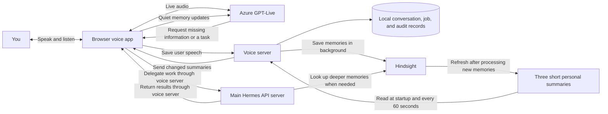

# Jarvis live voice

Jarvis is a browser voice assistant that uses Azure GPT-Live for conversation, Hindsight for personal memory, and your main Hermes (the same JARVIS as CLI and Telegram) for deeper lookups and background tasks. Familiar facts are available before you ask, so answering them does not require a memory search or a waiting announcement. Conversation stays available while Hermes works.

## Current status

As of 2026-10-15, seven fixes are live on branch `claude/voice-fixes` (Fixes 1-4 also merged to `main`). Each fix was checked with live test calls against a measurable definition of done ([fix plan](docs/VOICE-FIX-PLAN.md), evidence in `docs/evidence/`). 145 regression tests pass.

1. **No unasked results.** Connecting is silent. Results are spoken only in the call that asked for them, never after "stop".
2. **Same JARVIS.** Background work runs on the main Hermes profile's API server (Runs API), one Hermes session per call.
3. **Memory answers.** Questions about V are answered from memory, starting within 10 s, with follow-ups.
4. **Honest status.** Task name, state, minutes, latest step, plain failure reason.
5. **Let V finish (partial).** Jumps in during mid-sentence pauses 2 in 10 calls (was 4 in 5). GPT-Live has no turn-taking setting, so this is steered by instructions only.
6. **No made-up claims.** "Saved" only after the save completes; job claims only with a real job.
7. **Dropped calls.** After a reconnect it says only "We got cut off. Want me to finish what I was saying?" and never resumes a half sentence.

Also live: the 2026-10-14 logging fixes (browser playback and microphone state). Open: one test call greeted before anyone spoke (a regression check is running), and one requested result was read twice in a Fix 1 check (also seen Oct 9). The old `hermes-gateway-voice.service` is stopped and disabled.

## How it works

Audio runs directly between the browser and Azure. Memory processing and background work run separately, so loaded personal facts add no lookup to a spoken reply.

## Which memories are ready

Hindsight maintains three focused summaries using fixed selection rules:

| Summary | What it keeps ready |
| --- | --- |
| Personal profile | Name, important people, relationships, work, and lasting interests |
| Preferences | Likes, habits, and communication preferences |
| Current priorities | Up to five active commitments, priorities, or recent decisions, favoring newer evidence |

The facts change automatically as new information is saved. Explicit corrections take precedence over older facts. Questions and assistant guesses are not treated as personal facts. These rules select a small briefing; other memories still need a lookup.

After Hindsight processes new memories, it refreshes the summaries in the background, with at least 300 seconds between refreshes. The app checks for finished updates every 60 seconds and supplies changed sections to an ongoing voice conversation without announcing them. This is not a promise that every new fact appears within six minutes: processing time can add delay. Corrections spoken in the current conversation are already available there while durable memory updates finish.

If a summary cannot be refreshed, the app keeps its last usable version and reports a health warning. See the [memory design and update rules](docs/VOICE-MEMORY.md) and [testable goal](docs/VOICE-MEMORY-GOAL.md).

## Supporting documentation

- [Hindsight: focused mental models and automatic refresh](https://hindsight.vectorize.io/best-practices#mental-models) supports preparing short summaries for common personal questions.
- [Hermes: persistent personal memory](https://hermes-agent.nousresearch.com/docs/user-guide/features/memory) describes loading a compact user profile and useful facts at session start. The voice app gets its prepared summaries from Hindsight.
- [Microsoft: add context during a live conversation](https://learn.microsoft.com/azure/foundry/openai/how-to/gpt-live#add-context-during-the-conversation) documents `session.thinking.append`, used here for quiet memory updates. This guidance was verified through Microsoft Learn MCP.
- [Microsoft: delegate work in GPT-Live](https://learn.microsoft.com/azure/foundry/openai/how-to/gpt-live-delegation) documents handing work to an application while conversation continues.

The three summary categories and refresh timing are application choices built on these documented features. The integration uses existing APIs; it does not require Hermes or Hindsight source changes.

## Live browser clock

The browser supplies its current local date, time, and time zone throughout a call. A quiet update is sent when the call connects, when the minute or zone changes, and after returning to the tab if the clock changed. Jarvis answers ordinary date/time questions directly from the latest update, without a Hermes lookup or a waiting phrase. The clock has minute precision and uses natural spoken zone names.

Startup instructions tell the voice to use these updates. The updates themselves use Microsoft's documented [`session.thinking.append`](https://learn.microsoft.com/azure/foundry/openai/how-to/gpt-live#add-context-during-the-conversation) mechanism, so they do not trigger speech. They reuse the existing acknowledgment handling and stop when the call ends. No per-question model or memory request is added.

## Run and maintain

- Repository: [realtime-ai-voice-07-2026](https://github.com/vyente-ruffin/realtime-ai-voice-07-2026)
- Active checkout: `/home/localadmin/homelab/realtime-ai-voice-memory`
- Entry point: `src/live/server.js`; browser: `web/live.js`
- Persistent state: the private SQLite file selected by `VOICE_STATE_PATH`
- Runtime: `voice-frontend.service`; [deployment and rollback](deploy/live-production/README.md)
- Background work: main Hermes API server at `HERMES_API_URL` (key read from `API_SERVER_KEY` in `~/.hermes/.env`). Each call gets its own Hermes session. `VOICE_REASONING_EFFORT` sets task reasoning (default `medium`; empty uses the Hermes default).
- Live end-to-end checks: `scripts/live-e2e/` (headless Chrome with a fake microphone, its own test conversation; `cleanup.mjs` removes test memories afterward)

Use Node 26+, installed npm dependencies, a signed-in Azure CLI identity for the configured subscription, and the existing worker/memory configuration in the [app guide](docs/JARVIS-LIVE.md) and [environment example](.env.live.example). Keep credentials, personal memories, recordings, and detailed deployment records out of Git.

- Start an appropriately configured instance: `npm run start:live`
- Run isolated regression tests: `npm run test:live`
- Browser checks also require the existing Playwright Chromium installation.
- Wait until no conversation or background job is active before restarting the voice service. Reload the browser afterward to load updated scripts. Hermes updates no longer require a voice service restart.

Diagnostics write to the existing local audit table and service log. They do not add an in-app dashboard; Graylog delivery remains unverified.

When a call is silent or fails, the audit and log now show where it went wrong, tied to the browser call ID, conversation and session:
- the failing stage and error name (microphone, audio, session, provider, playback);
- microphone live/muted/disabled/ended, including mute and unmute during a call;
- playback received/playing/blocked/paused/stalled/ended;
- AudioContext state, including suspend/resume during a call;
- Azure status and request ID;
- provider error type/code and close reason;
- lost task/memory update streams;
- telemetry that was dropped or failed to send, counted per call;
- audit rows that could not be saved;
- background task state changes;
- failed memory saves and failed memory sends.

The newly added diagnostic fields hold only IDs, fixed state names, status codes and error names. They never hold message text, prompts, speech, device names, memory text or raw error messages. This does not change what was already stored: transcripts are still saved on purpose, and some older warnings (for example Hermes run and memory recall failures) still log the raw error message. "Playing" means the browser started the audio element, not that anyone heard it. These changes take effect only after an idle service restart and a browser reload ([ledger](ledger.md), 2026-10-14).

[Configuration, decisions, failures, and verification history](ledger.md)

2026-10-14 continuation: [machine handoff](CLAUDE.md), newest dated entry; logging source/test acceptance is recorded separately from still-unverified live adoption, with the earlier handoff preserved unchanged.
